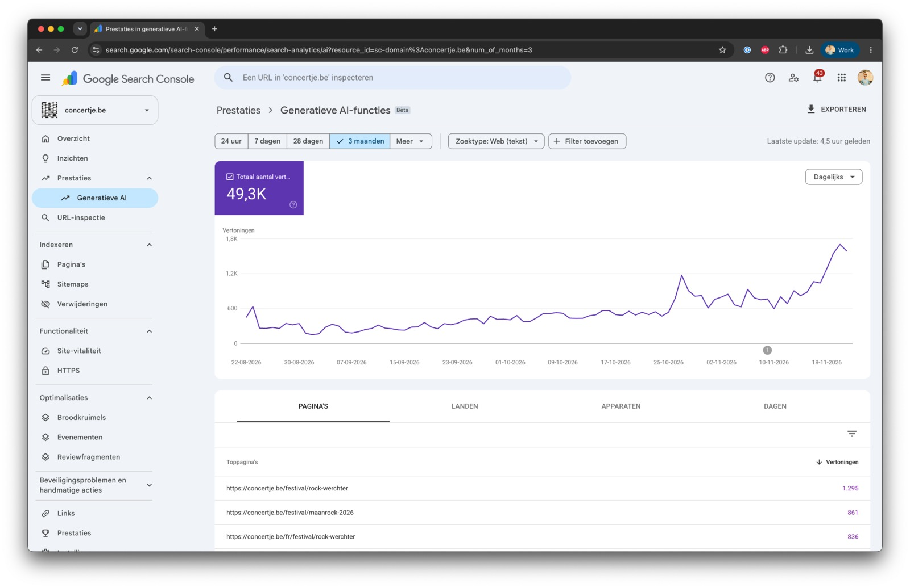

Ask an AI assistant "what's the best concert app for Belgium?" and it answers with a few names. For a long time, concertje wasn't one of them. Bandsintown was. Songkick was. Ticketmaster, somehow, was. When I asked AI search eight questions about concerts in Belgium in mid-November, concertje came up once, and that time the question was "concertje".

An assistant never opens the app, so making the app better doesn't help here. It reads pages and repeats what they say clearly. If my pages don't say what concertje is, who it's for and why you'd pick it, the assistant has nothing to repeat.

Google answers questions with AI now too, and Google's Search Console, the dashboard that shows how a site does in Google, has a new report that counts how often a site shows up in those answers. In the first week of October, concertje showed up about 465 times a day. In the third week of November it was about 1,600. This is what I changed in between, and what I'm still waiting to measure.

*Search Console's report on Google's AI answers, last 3 months.*

## Saying what concertje is

The first round of work ran from October to early November. Nowhere on the site did concertje plainly say what it was, so that's where I started.

I wrote an about page that says what concertje is, who it's for and who makes it, and every other place that describes concertje now uses the same text. The page written for AI assistants also says what you can actually do: that concertje is free, has no ads and works without an account, and that you can follow artists, get a reminder when tickets go on sale and see which concerts your friends are going to.

Then I added a page that answers "what's the best concert app for Belgium and the Netherlands?". It compares concertje with Bandsintown, Songkick and Ticketmaster, and it's honest about it: it says Bandsintown is the better pick if you often go to concerts abroad, and lists concertje's weak points too. A page that only praises concertje would read like an ad.

Festival pages got their common questions updated. People search "rock werchter 2027 lineup" and "wanneer tickets", so the questions now name the year and say when tickets go on sale. When the next edition hasn't announced anything yet, the page tells you when the festival announced its first acts and started selling tickets last year. Almost no other site gives that hint.

## A second opinion, with real data

By mid-November I'd done what I could think of myself and wanted a second opinion. I used two free tools.

The first is a [set of SEO and AI-search skills](https://github.com/aaron-he-zhu/seo-geo-claude-skills) for Claude Code: instructions that teach it how to audit a website the way an SEO consultant would. The second is [gsc-cli](https://github.com/benedict2310/gsc-cli), which lets Claude Code read my Google Search Console data.

I had Claude Code look at the site from four angles at once: the technical side, how each page presents itself in Google, how pages link to each other, and whether AI search mentions concertje at all.

The Google data made the biggest difference. An audit like this produces a lot of generic advice. With the real numbers at hand, every suggestion had to match what people actually search for and click on.

### What it found

I wouldn't have found most of these myself:

- The Dutch site blocked AI assistants from reading it, while the Belgian site let them in. Everything I'd written for them was invisible on concertje.nl.
- Google hadn't looked at the list of Dutch pages since July.
- Festival pages showed up in Google a lot, but almost nobody clicked. The short text under the link was the festival description cut off halfway, so it rarely got to a name or a date.
- 21 festivals that were between editions, like Crammerock and Maanrock, still had a page, but nothing linked to it. Google had lost track of some of them.

Most fixes were small. The text under festival links now names the dates, the city and the best-known acts. The 21 festivals are back in the festival list, and Google got a fresh list of Dutch pages.

## The numbers

How often concertje appeared in Google's AI answers:

- Early September: about 250 times a day.
- First week of October: about 465 a day.
- Late October to mid-November: 600 to 900 a day.
- From 16 November it climbs, to 1,702 on 20 November.
- 19 to 21 November: about 1,600 a day, three and a half times early October.

Festival pages get most of them. Rock Werchter alone showed up about 2,700 times across the Dutch, French and English versions of its page.

Regular Google search grew less. Between the first week of October and mid-November, appearances went up by about 40% and so did clicks. The most common searches are now the ones the festival questions answer, like "graspop 2027" and "rock werchter 2027 lineup".

Search "rock werchter 2027 lineup" today and concertje is on the first page, after two pages of the festival's own site, Festileaks and Clashfinder. The text under the link is the new one: the headliners and the day each one plays.

*concertje on the first page for "rock werchter 2027 lineup".*

## Looking back

I'm not an SEO person, and I didn't hire one. I used a set of skills someone else wrote and a small tool that reads my Google data, and together they found problems I didn't know I had. The skills gave me a checklist, and the Google data decided which items on it were worth doing. If you have a side project and no budget for a consultant, these tools are free and they can make a big difference.

Everything in this article was something I could change on my own site: how concertje describes itself, which questions its pages answer, which pages Google can find. That part is going well. concertje shows up in Google's AI answers more than three times as often as in early October, and it's on the first page for searches it never reached before.

The next step is harder, because I can't fix it on my own site. Google trusts a site more when other sites link to it, which is why Bozar and De Roma outrank concertje on their own concerts. Right now almost no one else writes about concertje or links to it. Getting there means press, partnerships with venues and festivals, and artists linking to their concertje page.
